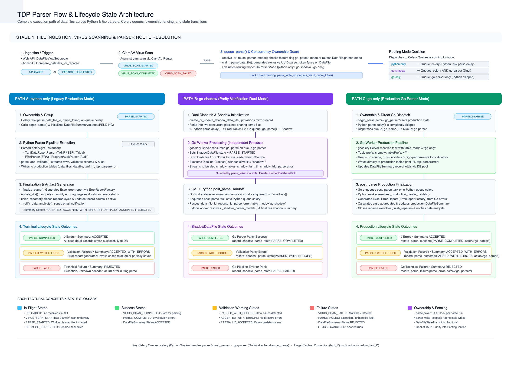

# Parsing Architecture: Python Parser vs. Go Parser

This document details the parsing architecture in TANF-app, how the Python parser and the Go parser work, how routing decisions are made, and how tasks are invoked and finalized across Celery workers.

---

## Architecture Overview

Parsing in TDP is orchestrated through Celery tasks, a persisted routing mode on each submission, and concurrency ownership tokens. The system supports three execution modes defined by [`GoParserMode`](file:///Users/hschwarz/Documents/Projects/TDP/dev/TANF-app/tdrs-backend/tdpservice/data_files/enums.py#L6-L11):

1. **`python-only`**: Dispatches only the legacy Python parser.
2. **`go-shadow`**: Dispatches the Python parser to production tables **and** the Go parser to shadow tables (`shadow_*`) for validation parity testing.
3. **`go-only`**: Dispatches only the Go parser directly to production tables.

---

## 1. Dispatch & Routing (`queue_parse`)

When a file passes virus scanning or is re-parsed, [`queue_parse`](file:///Users/hschwarz/Documents/Projects/TDP/dev/TANF-app/tdrs-backend/tdpservice/scheduling/parser_task.py#L154-L205) in [`parser_task.py`](file:///Users/hschwarz/Documents/Projects/TDP/dev/TANF-app/tdrs-backend/tdpservice/scheduling/parser_task.py) handles routing and ownership:

1. **Mode Resolution**: [`resolve_or_reuse_parser_mode`](file:///Users/hschwarz/Documents/Projects/TDP/dev/TANF-app/tdrs-backend/tdpservice/scheduling/parser_task.py#L99-L108) queries the feature flag `go_parser_mode` (or reuses the existing `data_file.parser_mode` so a reparse always uses the same parser mode as its initial run).
2. **Shadow Record Creation**: In `go-shadow` mode, [`create_or_update_shadow_data_file`](file:///Users/hschwarz/Documents/Projects/TDP/dev/TANF-app/tdrs-backend/tdpservice/data_files/models.py) provisions a mirror record in [`ShadowDataFile`](file:///Users/hschwarz/Documents/Projects/TDP/dev/TANF-app/tdrs-backend/tdpservice/data_files/models.py).
3. **Ownership Claim**: [`claim_parse`](file:///Users/hschwarz/Documents/Projects/TDP/dev/TANF-app/tdrs-backend/tdpservice/data_files/submission_lifecycle.py#L31) generates an exclusive UUID `parse_token` to prevent stale or race-condition writes.
4. **Queueing**:
   - If mode is `python-only` or `go-shadow`: Enqueues the Python task [`parse.delay(...)`](file:///Users/hschwarz/Documents/Projects/TDP/dev/TANF-app/tdrs-backend/tdpservice/scheduling/parser_task.py#L712) onto the default `celery` queue.
   - If mode is `go-only`: Transitions lifecycle to `PARSE_STARTED` via [`begin_parse`](file:///Users/hschwarz/Documents/Projects/TDP/dev/TANF-app/tdrs-backend/tdpservice/data_files/submission_lifecycle.py#L30).
   - If mode is `go-shadow` or `go-only`: Calls [`queue_go_parse`](file:///Users/hschwarz/Documents/Projects/TDP/dev/TANF-app/tdrs-backend/tdpservice/scheduling/parser_task.py#L111-L152) sending `tdpservice.scheduling.parser_task.go_parse` onto the dedicated `go-parser` Celery queue.

---

## 2. Python Parser Execution

When a Python Celery worker handles [`parse`](file:///Users/hschwarz/Documents/Projects/TDP/dev/TANF-app/tdrs-backend/tdpservice/scheduling/parser_task.py#L712-L873):

1. **State & Setup**: Calls [`begin_parse`](file:///Users/hschwarz/Documents/Projects/TDP/dev/TANF-app/tdrs-backend/tdpservice/data_files/submission_lifecycle.py#L30) to mark `PARSE_STARTED` and initializes [`DataFileSummary`](file:///Users/hschwarz/Documents/Projects/TDP/dev/TANF-app/tdrs-backend/tdpservice/parsers/models.py#L53) with `status=PENDING`.
2. **Parser Selection**: Uses [`ParserFactory.get_instance`](file:///Users/hschwarz/Documents/Projects/TDP/dev/TANF-app/tdrs-backend/tdpservice/parsers/factory.py#L32) to instantiate the appropriate class:
   - [`TanfDataReportParser`](file:///Users/hschwarz/Documents/Projects/TDP/dev/TANF-app/tdrs-backend/tdpservice/parsers/parser_classes/tdr_parser.py) (for TANF, SSP, Tribal)
   - [`FRAParser`](file:///Users/hschwarz/Documents/Projects/TDP/dev/TANF-app/tdrs-backend/tdpservice/parsers/parser_classes/fra_parser.py) (for FRA)
   - [`ProgramAuditParser`](file:///Users/hschwarz/Documents/Projects/TDP/dev/TANF-app/tdrs-backend/tdpservice/parsers/parser_classes/program_audit_parser.py) (for program audit files)
3. **Parse & Write**: Inherits from [`BaseParser`](file:///Users/hschwarz/Documents/Projects/TDP/dev/TANF-app/tdrs-backend/tdpservice/parsers/parser_classes/base_parser.py#L34). Decodes rows, applies schema validation rules, and bulk-inserts records and [`ParserError`](file:///Users/hschwarz/Documents/Projects/TDP/dev/TANF-app/tdrs-backend/tdpservice/parsers/models.py#L54) instances wrapped in [`parse_write_scope`](file:///Users/hschwarz/Documents/Projects/TDP/dev/TANF-app/tdrs-backend/tdpservice/data_files/submission_lifecycle.py#L33) (verifying token ownership).
4. **Finalization**:
   - [`_finalize_parse`](file:///Users/hschwarz/Documents/Projects/TDP/dev/TANF-app/tdrs-backend/tdpservice/scheduling/parser_task.py#L436): Generates the downloadable error report via [`ErrorReportFactory`](file:///Users/hschwarz/Documents/Projects/TDP/dev/TANF-app/tdrs-backend/tdpservice/data_files/error_reports.py#L21) and updates [`DataFileSummary`](file:///Users/hschwarz/Documents/Projects/TDP/dev/TANF-app/tdrs-backend/tdpservice/parsers/models.py#L53) with monthly error aggregates.
   - [`_transition_parse_outcome`](file:///Users/hschwarz/Documents/Projects/TDP/dev/TANF-app/tdrs-backend/tdpservice/scheduling/parser_task.py#L368): Transitions lifecycle state to `PARSE_COMPLETED` or `PARSED_WITH_ERRORS`.
   - Sends notification emails via [`_notify_data_analysts`](file:///Users/hschwarz/Documents/Projects/TDP/dev/TANF-app/tdrs-backend/tdpservice/scheduling/parser_task.py#L389) and closes any active reparse.

---

## 3. Go Parser Execution

The Go parser runs as an independent daemon worker built on GoCelery:

1. **Celery Consumer**: [`Server.Run`](file:///Users/hschwarz/Documents/Projects/TDP/dev/TANF-app/tdrs-services/parser/internal/server/celery/celery.go#L117) listens on Redis queue `go-parser` for task `tdpservice.scheduling.parser_task.go_parse`.
2. **Task Processing ([`processTask`](file:///Users/hschwarz/Documents/Projects/TDP/dev/TANF-app/tdrs-services/parser/internal/server/celery/celery.go#L317))**:
   - Determines the target table prefix: `"shadow_"` for `go-shadow` or `""` for `go-only`.
   - Fetches metadata from PostgreSQL ([`db.GetDataFile`](file:///Users/hschwarz/Documents/Projects/TDP/dev/TANF-app/tdrs-services/parser/internal/db/datafile.go)) and downloads the file from S3 ([`reader.NewS3Source`](file:///Users/hschwarz/Documents/Projects/TDP/dev/TANF-app/tdrs-services/parser/internal/storage/reader/s3.go)).
   - Creates a guarded database sink ([`writer.CreateGuardedDatabaseSink`](file:///Users/hschwarz/Documents/Projects/TDP/dev/TANF-app/tdrs-services/parser/internal/storage/writer/factory.go)) enforcing the `parse_token`.
   - Executes the Go parsing pipeline ([`Pipeline.Process`](file:///Users/hschwarz/Documents/Projects/TDP/dev/TANF-app/tdrs-services/parser/internal/pipeline/pipeline.go#L89)), streaming parsed data rows and validation errors directly to the target PostgreSQL tables.
3. **Post-Parse Handoff ([`enqueuePostParseTask`](file:///Users/hschwarz/Documents/Projects/TDP/dev/TANF-app/tdrs-services/parser/internal/server/celery/celery.go#L292))**:
   - In a `defer` block (ensuring recovery from any panics or errors), Go dispatches `tdpservice.scheduling.parser_task.post_parse` onto the Python `celery` queue, passing `dataFileID`, `reparseID`, any `parseError`, `mode`, `parseToken`, and `eventID`.

---

## 4. Post-Parse Orchestration (`post_parse`)

When the Python Celery worker picks up [`post_parse`](file:///Users/hschwarz/Documents/Projects/TDP/dev/TANF-app/tdrs-backend/tdpservice/scheduling/parser_task.py#L586-L710):

1. **Model Resolution**: Resolves whether to operate on shadow models ([`ShadowDataFile`](file:///Users/hschwarz/Documents/Projects/TDP/dev/TANF-app/tdrs-backend/tdpservice/data_files/models.py#L25), [`ShadowDataFileSummary`](file:///Users/hschwarz/Documents/Projects/TDP/dev/TANF-app/tdrs-backend/tdpservice/parsers/models.py#L56), [`ShadowParserError`](file:///Users/hschwarz/Documents/Projects/TDP/dev/TANF-app/tdrs-backend/tdpservice/parsers/models.py#L57)) or production models ([`DataFile`](file:///Users/hschwarz/Documents/Projects/TDP/dev/TANF-app/tdrs-backend/tdpservice/data_files/models.py#L23), [`DataFileSummary`](file:///Users/hschwarz/Documents/Projects/TDP/dev/TANF-app/tdrs-backend/tdpservice/parsers/models.py#L53), [`ParserError`](file:///Users/hschwarz/Documents/Projects/TDP/dev/TANF-app/tdrs-backend/tdpservice/parsers/models.py#L54)) via [`_parser_models_for_mode`](file:///Users/hschwarz/Documents/Projects/TDP/dev/TANF-app/tdrs-backend/tdpservice/scheduling/parser_task.py#L272).
2. **Summary & Error Artifacts**: Runs [`_finalize_parse`](file:///Users/hschwarz/Documents/Projects/TDP/dev/TANF-app/tdrs-backend/tdpservice/scheduling/parser_task.py#L436) to generate the formatted Excel error report from the errors Go inserted, calculates monthly summary status and aggregate counts, and updates the summary model.
3. **State Transition**:
   - For `go-shadow`: Records [`record_shadow_parse_state`](file:///Users/hschwarz/Documents/Projects/TDP/dev/TANF-app/tdrs-backend/tdpservice/data_files/submission_lifecycle.py#L37).
   - For `go-only`: Calls [`record_parse_outcome`](file:///Users/hschwarz/Documents/Projects/TDP/dev/TANF-app/tdrs-backend/tdpservice/data_files/submission_lifecycle.py#L36) for production lifecycle transitions and closes the reparse workflow via [`finish_reparse`](file:///Users/hschwarz/Documents/Projects/TDP/dev/TANF-app/tdrs-backend/tdpservice/data_files/submission_lifecycle.py#L32).

---

## 5. Context for Issue #5570 Re-Implementation

In the current `develop` codebase:
- All orchestration logic (model resolution, summary calculation, error report generation, state transition logging, and post-parse cleanup) is embedded procedurally inside [`tdrs-backend/tdpservice/scheduling/parser_task.py`](file:///Users/hschwarz/Documents/Projects/TDP/dev/TANF-app/tdrs-backend/tdpservice/scheduling/parser_task.py).
- **The objective of #5570** is to extract this logic into an object-oriented domain service (`ParsingService` in `tdrs-backend/tdpservice/parsers/service.py`).
- This allows parsing and post-parse finalization to be invoked directly and synchronously (e.g., in unit tests, scripts, or management commands) without coupling to Celery runtime structures, leaving `parser_task.py` as a lightweight dispatch wrapper.

