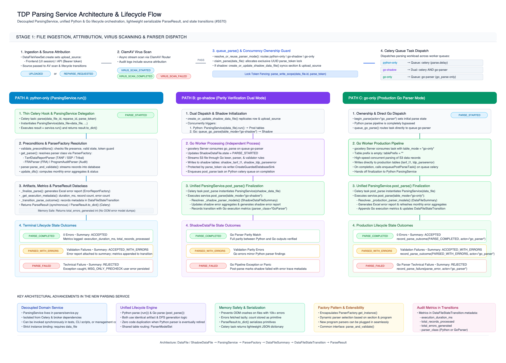

# Dedicated Parsing Service Architecture & Lifecycle Flow

This document details the refactored parsing architecture in the TDP backend ([Issue #5570](https://github.com/raft-tech/TANF-app/issues/5570)). It explains how [`ParsingService`](../../tdrs-backend/tdpservice/parsers/service.py) decouples parsing lifecycle management from Celery task execution, how traffic is routed between the Python and Go parsers, how the transient Python parser engine is separated from permanent Django lifecycle concerns, and how post-parse finalization is unified across all execution modes.

---

## Architectural Diagrams

- **Visual Diagram (PNG)**: 
- **Editable Source (Draw.io)**: [`diagrams/parsing-service-flow.drawio`](diagrams/parsing-service-flow.drawio) (can be opened and edited with [app.diagrams.net](https://app.diagrams.net) or the VS Code Draw.io extension)
- **Editable Source (Draw.io)**: [`diagrams/python-parsing-flow.drawio`](diagrams/python-parsing-flow.drawio) Python Parser Flow
- **Editable Source (Draw.io)**: [`diagrams/golang-parsing-flow.drawio`](diagrams/golang-parsing-flow.drawio) Go Parser Flow

---

## 1. Architectural Motivation & Design Principles

Historically, file parsing was implemented inside [`tdpservice.scheduling.parser_task`](../../tdrs-backend/tdpservice/scheduling/parser_task.py) as a monolithic ~900-line Celery task. That design suffered from several architectural deficiencies:
1. **Coupling to Celery Infrastructure**: Parsing logic could not be invoked synchronously in unit tests, management commands, or CLI tools without mocking Celery internals.
2. **Memory Crashes (OOM)**: Celery task return values serialized thousands of Django model instances (`ParserError`), causing worker out-of-memory crashes on large files.
3. **Fragmentation Across Parsers**: As the high-performance Go parser was introduced, task dispatching, shadow table synchronization, and post-parse finalization were split haphazardly between Celery tasks and external workers.
4. **Transient vs. Permanent Concerns**: Because the legacy Python parser will eventually be deprecated and removed once the Go parser reaches 100% parity, organizing the service strictly around Python class selection would mean the service would become obsolete and deleted when Python is retired.

### Core Architectural Decisions

- **Permanent Lifecycle Orchestrator**: [`ParsingService`](../../tdrs-backend/tdpservice/parsers/service.py#L779) is the permanent orchestrator for DataFile submission lifecycles. It permanently owns:
  - Task scheduling and route evaluation (`ParsingService.schedule()`).
  - Concurrency ownership locking and token verification (`claim_parse`, `parse_token`).
  - Terminal state transitions (`SubmissionState.PARSE_COMPLETED`, `PARSED_WITH_ERRORS`, `PARSE_FAILED`).
  - Post-parse finalization for both Python and Go (`post_parse()`).
  - DataFileSummary aggregate calculations, error report generation, and analyst email notifications.
- **Decoupled Transient Engine**: The legacy Python parsing execution is isolated inside [`PythonParserEngine`](../../tdrs-backend/tdpservice/parsers/service.py#L740). When the team moves 100% of traffic to Go, **only `PythonParserEngine` and its subpackages are deleted**—the lifecycle service remains 100% intact.
- **Ultra-Thin Celery Task Layer**: [`tdpservice.scheduling.parser_task`](../../tdrs-backend/tdpservice/scheduling/parser_task.py) is reduced to an ~80-line module containing strictly `@shared_task` decorators and backward-compatible dispatch shims.
- **Memory Safety & Serialization**: [`ParseResult`](../../tdrs-backend/tdpservice/parsers/service.py#L78) stores total error counts lazily and implements `to_dict()`, ensuring Celery tasks return only lightweight JSON primitives.

---

## 2. Ingestion, Source Attribution & Dispatch (Stage 1)

When a data file is uploaded to TDP, it flows through three pre-parsing stages:

```
[ Frontend / API Upload ]
           │
           ▼
[ DataFileViewSet.create ] ──► Records upload_source ("Frontend" | "API")
           │
           ▼
[ ClamAV Antivirus Scan ] ──► VIRUS_SCAN_COMPLETED
           │
           ▼
[ ParsingService.schedule() ] (alias: queue_parse)
    ├─ 1. resolve_or_reuse_parser_mode() ──► Evaluates "go_parser_mode" flag or reuses mode
    ├─ 2. claim_parse() ──────────────────► Issues exclusive UUID parse_token lock
    └─ 3. create_or_update_shadow_data_file() [if in go-shadow mode]
```

### 1. Source Attribution
[`DataFileViewSet.create`](../../tdrs-backend/tdpservice/data_files/views.py) inspects the incoming request and records `upload_source`:
- **`Frontend`**: Upload initiated via browser UI session.
- **`API`**: Upload initiated via automated machine-to-machine API client with Bearer token authentication.

### 2. Antivirus Scan
The submission transitions to `VIRUS_SCAN_PENDING` and is scanned by ClamAV. Upon clean scan completion, the file transitions to `VIRUS_SCAN_COMPLETED` and invokes `ParsingService.schedule()`.

### 3. Concurrency Lock & Mode Resolution
[`ParsingService.schedule(data_file_id)`](../../tdrs-backend/tdpservice/parsers/service.py#L827):
1. **Mode Resolution**: Queries [`resolve_or_reuse_parser_mode(data_file_id)`](../../tdrs-backend/tdpservice/parsers/service.py#L638). If `data_file.parser_mode` is already persisted (such as during a reparse), it reuses that mode; otherwise, it evaluates the `go_parser_mode` feature flag.
2. **Shadow Preparation**: In `go-shadow` mode, provisions or updates [`ShadowDataFile`](../../tdrs-backend/tdpservice/data_files/models.py) to mirror the production submission metadata.
3. **Parse Token Claim**: Calls [`claim_parse(data_file)`](../../tdrs-backend/tdpservice/data_files/submission_lifecycle.py#L31), allocating an exclusive UUID `parse_token`. Any subsequent writes must present this token via [`parse_write_scope`](../../tdrs-backend/tdpservice/data_files/submission_lifecycle.py#L30) to prevent concurrent or stale task overwrites.

---

## 3. The Three Parser Execution Paths (Stage 2)

Traffic is routed dynamically based on [`GoParserMode`](../../tdrs-backend/tdpservice/data_files/enums.py):

| Traffic Mode | Celery Tasks Dispatched | Target Database Partition | Authoritative Outcome |
| :--- | :--- | :--- | :--- |
| **`python-only`** | `parse.delay(...)` | Production tables | Python parser |
| **`go-shadow`** | `parse.delay(...)` AND `queue_go_parse(...)` | Production tables (Python) + Shadow tables (Go) | Python parser (Go is audit-only) |
| **`go-only`** | `queue_go_parse(...)` | Production tables | Go parser worker |

### Path A: `python-only` Execution Flow
1. **Celery Wrapper**: Celery task `parse(data_file_id, ...)` runs on the Python worker queue.
2. **Service Construction**: Instantiates `service = ParsingService(data_file=data_file, ...)` and executes `result = service.run()`.
3. **Precondition Validation**: Checks that the file exists, the submission is in an allowable parse-queueable state, and the `parse_token` matches the active claim.
4. **Engine Delegation**: Calls [`PythonParserEngine`](../../tdrs-backend/tdpservice/parsers/service.py#L740), which queries [`ParserFactory.get_instance`](../../tdrs-backend/tdpservice/parsers/factory.py) to select:
   - `TanfDataReportParser` (TANF / SSP / Tribal)
   - `FRAParser` (FRA Work Outcomes)
   - `ProgramAuditParser` (Audit submissions)
5. **Record Streaming**: The parser decodes file lines, executes validation routines, and bulk-inserts rows and [`ParserError`](../../tdrs-backend/tdpservice/parsers/models.py) entries wrapped in `parse_write_scope`.
6. **Finalization (`_finalize_parse`)**:
   - Updates [`DataFileSummary`](../../tdrs-backend/tdpservice/parsers/models.py) with error aggregations by month.
   - Generates downloadable Excel error report via [`ErrorReportFactory`](../../tdrs-backend/tdpservice/data_files/error_reports.py).
   - Appends duration, record counts, error counts, and `parser_class` to [`DataFileStateTransition.metadata`](../../tdrs-backend/tdpservice/data_files/models.py).
   - Transitions state to `PARSE_COMPLETED`, `PARSED_WITH_ERRORS`, or `PARSE_FAILED`.
   - Sends notification emails to STT Data Analysts via [`send_data_submitted_email`](../../tdrs-backend/tdpservice/email/helpers/data_file.py).

### Path B: `go-shadow` Dual Dispatch Flow
1. **Parallel Dispatch**: `ParsingService.schedule()` dispatches:
   - Python parse task `parse.delay(...)` to default `celery` queue.
   - Go parse task `queue_go_parse(...)` to dedicated `go-parser` Redis queue.
2. **Isolated Processing**:
   - The Python parser processes the production `DataFile` and writes to production tables.
   - The Go worker consumes the task, parses the file, and writes strictly to shadow tables (`shadow_tanf_t1...t7`, `ShadowParserError`, `ShadowDataFileSummary`).
3. **Go Finalization via `post_parse`**:
   - The Go worker dispatches Celery task `post_parse(data_file_id, table_mode="go-shadow")` back to Django.
   - Django invokes `ParsingService.for_post_parse(table_mode="go-shadow")`, which finalizes the `ShadowDataFileSummary` without sending analyst emails or altering production state.
4. **Audit Parity Testing**: Diffs between production and shadow tables verify that Go produces byte-for-byte and error-for-error equivalence before live traffic is switched.

### Path C: `go-only` Production Execution Flow
1. **Direct Dispatch**: `ParsingService.schedule()` transitions `DataFile.state` directly to `PARSE_STARTED` (`actor="go_parser"`) and dispatches `queue_go_parse(table_mode="go-only")`. Python parsing is bypassed.
2. **High-Performance Worker**: The external Go worker streams and validates the file, inserting records and errors directly into production tables.
3. **Authoritative Finalization**:
   - The Go worker invokes `post_parse(data_file_id, table_mode="go-only")`.
   - Django executes `ParsingService.for_post_parse(table_mode="go-only")`.
   - Generates the official error report, updates `DataFileSummary`, attaches execution metadata to `DataFileStateTransition`, transitions `DataFile.state`, and notifies data analysts.

---

## 4. Key Architectural Components

### `ParsingService` (`tdpservice/parsers/service.py`)
The permanent lifecycle orchestrator.
```python
class ParsingService:
    def __init__(self, data_file: Union[DataFile, ShadowDataFile], ...):
        ...

    @property
    def uses_shadow_table(self) -> bool:
        """Return True if bound to a ShadowDataFile."""

    @classmethod
    def schedule(cls, data_file_id: int, reparse_id=None, event_id=None) -> uuid.UUID:
        """Route, lock, and schedule parse execution across worker queues."""

    @classmethod
    def for_post_parse(cls, data_file_id: int, table_mode=None, ...) -> "ParsingService":
        """Factory method resolving DataFile vs ShadowDataFile for post-parse completion."""

    def run(self) -> ParseResult:
        """Execute parsing, lifecycle transitions, and post-parse finalization."""

    def post_parse(self, parse_error=None, table_mode=None, task_name=None):
        """Finalize Go parser worker execution in its selected table family."""
```

### `PythonParserEngine` (`tdpservice/parsers/service.py`)
The transient engine isolating legacy Python parsing logic.
```python
class PythonParserEngine:
    def __init__(self, data_file, dfs=None, parse_token=None):
        self.data_file = data_file
        self.dfs = dfs
        self.parse_token = parse_token

    def get_parser(self):
        """Resolve parser class via ParserFactory."""
        return ParserFactory.get_instance(...)

    def execute(self):
        """Execute legacy line-by-line parsing and validation."""
        parser = self.get_parser()
        parser.parse()
        return parser
```

### `ParseResult` Dataclass
Memory-safe execution summary returned by `ParsingService.run()`.
```python
@dataclass
class ParseResult:
    success: bool
    data_file: Optional[Union[DataFile, ShadowDataFile]] = None
    summary: Optional[Union[DataFileSummary, ShadowDataFileSummary]] = None
    status: Optional[str] = None
    error_message: Optional[str] = None
    total_records_processed: int = 0
    total_errors_generated: int = 0

    def to_dict(self) -> dict[str, Any]:
        """Return a lightweight, JSON-serializable dictionary with primitives."""
        return {
            "success": self.success,
            "data_file_id": getattr(self.data_file, "id", None),
            "summary_id": getattr(self.summary, "id", None),
            "status": self.status,
            "error_message": self.error_message,
            "total_records_processed": self.total_records_processed,
            "total_errors_generated": self.total_errors_generated,
        }
```

### Celery Task Layer (`tdpservice/scheduling/parser_task.py`)
Ultra-thin Celery wrapper module (~80 lines):
```python
@shared_task(name=GO_PARSER_TASK_NAME)
def go_parse(data_file_id: int, ...):
    raise RuntimeError("Routed to external Go parser worker")

@shared_task(name=GO_PARSER_POST_PARSE_TASK_NAME)
def post_parse(data_file_id: int, table_mode=None, ...):
    service = ParsingService.for_post_parse(data_file_id=data_file_id, table_mode=table_mode, ...)
    service.post_parse(...)

@shared_task
def parse(data_file_id, ...):
    data_file = DataFile.objects.get(id=data_file_id)
    service = ParsingService(data_file=data_file, ...)
    result = service.run()
    return result.to_dict()
```

---

## 5. Usage Guide

### Scheduling a Data File for Parsing
To dispatch a submission through the standard routing pipeline:
```python
from tdpservice.parsers.service import ParsingService

parse_token = ParsingService.schedule(data_file_id=data_file.id)
```

### Running Synchronously (Tests & CLI Tools)
To parse a file synchronously in a unit test or management command without Celery:
```python
from tdpservice.parsers.service import ParsingService

service = ParsingService(data_file=data_file)
result = service.run()

if result.success:
    print(f"Parsed {result.total_records_processed} records in {result.status} state.")
else:
    print(f"Parsing failed: {result.error_message}")
```

### Finalizing Go Parser Output
When a Go worker completes, it posts to the `post_parse` task:
```python
from tdpservice.parsers.service import ParsingService

service = ParsingService.for_post_parse(
    data_file_id=data_file.id,
    table_mode="go-only",
)
service.post_parse(parse_error=None)
```

---

## 6. Deprecation Roadmap for Python Parser

Once shadow parity testing confirms that the Go parser matches the Python parser with 100% fidelity:
1. **Update Feature Flag**: Set `go_parser_mode` to `{"mode": "go-only"}` in production. All incoming submissions will route directly to Go.
2. **Remove Python Engine**:
   - Delete `PythonParserEngine` from `tdpservice/parsers/service.py`.
   - Remove `tdpservice/parsers/tanf/`, `tdpservice/parsers/ssp/`, `tdpservice/parsers/factory.py`, and legacy parser classes.
   - Remove the `parse` Celery task from `parser_task.py`.
3. **Keep `ParsingService` Intact**:
   - `ParsingService.schedule()` will route directly to `queue_go_parse`.
   - `ParsingService.for_post_parse()` and `post_parse()` will continue finalizing all submissions, generating error reports, transitioning states, and notifying data analysts.
   - **Zero rework is needed for Django models, state machines, audit trails, or notifications.**
